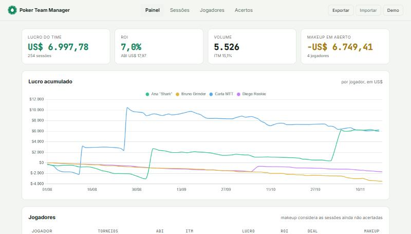
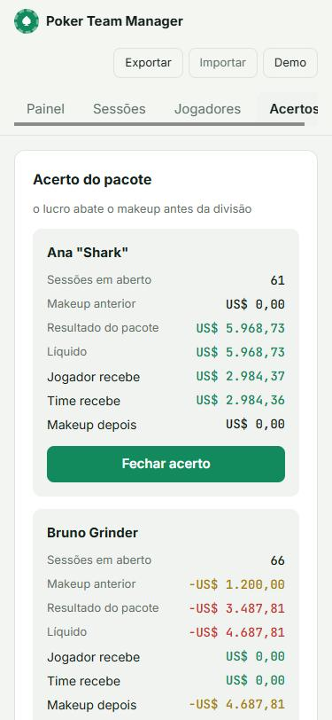

# Poker Team Manager

> *Dashboard for running a backed poker team: per-player stats (ROI, ABI, ITM, volume), staking deals with makeup and one-click package settlements. Zero build step, runs on GitHub Pages.*

**[▶ Abrir a demo](https://guilhermesgl.github.io/poker-team-manager/)** · dados fictícios

Painel para quem gerencia um time de poker com stake: acompanha o resultado de cada jogador, controla o makeup e calcula o acerto de cada pacote, mostrando quanto vai para o jogador e quanto fica com o time.

Nasceu da minha rotina real como jogador profissional e gerente de time: as contas de makeup e de divisão de lucro costumam viver em planilhas frágeis, e um erro numa delas vira discussão com o jogador.



## Funcionalidades

- **Painel do time:** lucro, ROI, ABI, volume, ITM e makeup em aberto, com gráfico de lucro acumulado por jogador.
- **Sessões:** registro por jogador, data e site (torneios, ITM, buy-ins, prêmios), com filtro.
- **Deals:** porcentagem do lucro de cada jogador e makeup inicial.
- **Acertos:** simulação ao vivo do pacote e fechamento em um clique, com histórico. Sessões acertadas ficam travadas.
- **Seus dados ficam com você:** tudo no navegador (localStorage), com exportar e importar em JSON.
- Funciona no celular, em tema claro e escuro.



## A regra do acerto

```
líquido = makeup anterior + resultado do pacote
se líquido <= 0  → ninguém recebe; o makeup passa a ser o líquido
se líquido  > 0  → jogador recebe líquido × deal; time recebe o resto; makeup zera
```

Exemplo: makeup de -US$ 3.000, pacote de +US$ 5.000, deal de 40% → líquido US$ 2.000 → jogador US$ 800, time US$ 1.200.

A regra está isolada em [`js/model.js`](js/model.js) como funções puras e coberta por testes.

## Rodar e testar

Não tem build. Qualquer servidor estático serve:

```bash
python -m http.server 8000
# abra http://localhost:8000
```

Testes (Node 20+):

```bash
npm test
```

## Estrutura

```
index.html        layout e abas
css/styles.css    tema (claro/escuro) e layout responsivo
js/model.js       regras: estatísticas, acerto com makeup, lucro acumulado
js/app.js         interface, armazenamento, importar/exportar
js/demo.js        gerador determinístico de dados fictícios
test/             testes do modelo (node:test)
```

## Próximos passos

- Importar resultados direto de hand histories e summaries dos sites ([poker-hand-analyzer](https://github.com/GuilhermeSGL/poker-hand-analyzer)).
- Backend com login para o time inteiro ver o mesmo painel.
- Deals com regras extras: stop-loss, divisão escalonada e cobertura de rakeback.

---
Feito por [Guilherme](https://github.com/GuilhermeSGL). Licença MIT.
